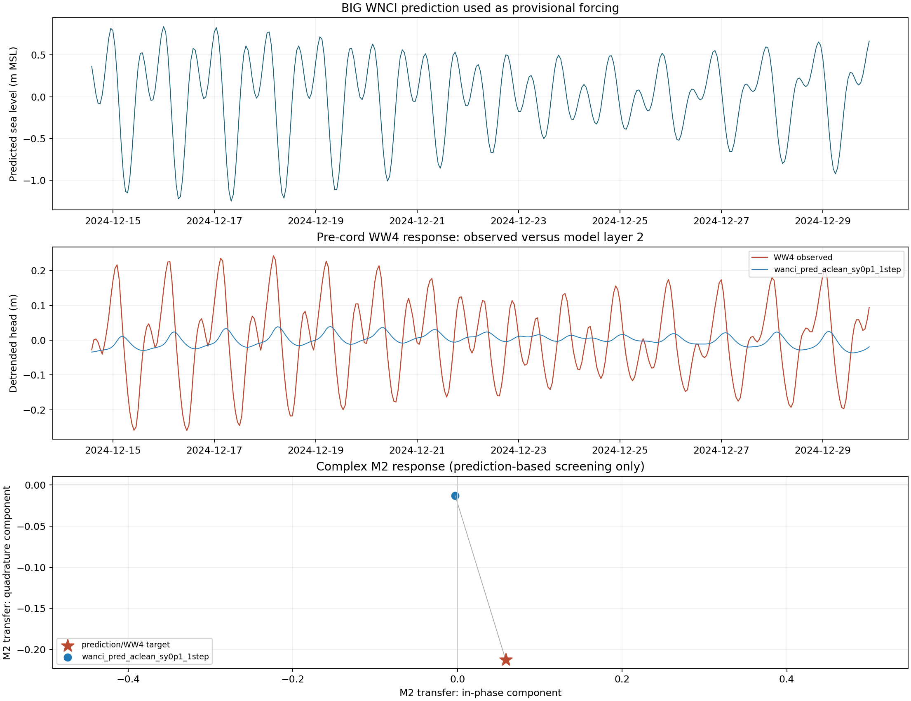
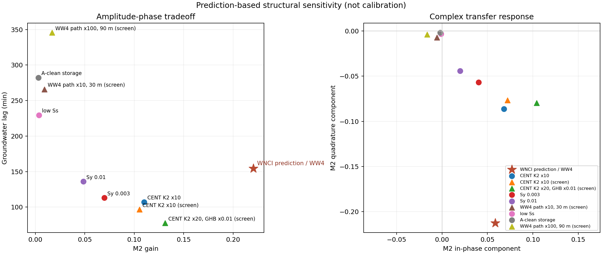
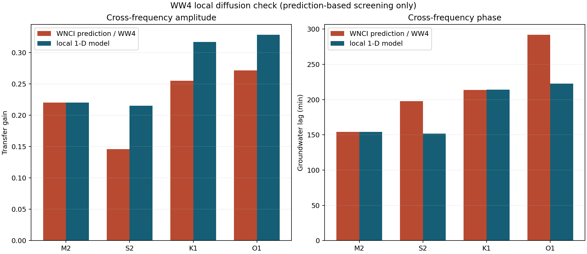

# Wangi-Wangi SWI model: predicted-tide assessment

**Updated:** 2026-10-01  
**Status:** Preliminary structural sensitivity using BIG WNCI predicted tide.
This is not calibration or validation with observed tide-gauge data.

## Main result

The A-clean regional model completed the 544-hour WNCI-prediction run
successfully in 15.1 minutes. However, it strongly attenuates the tidal response
at WW4.

| Metric | WNCI prediction / WW4 | A-clean model |
|---|---:|---:|
| M2 transfer gain | 0.220 | 0.0135 |
| Groundwater lag | 154 min | 210 min |
| WW4 M2 amplitude | 0.100 m | 0.0061 m |

The modelled M2 amplitude is about one sixteenth of the monitored WW4 amplitude.
The regional steady-head calibration therefore does not reproduce the local
dynamic connection between the coast and WW4.

## Structural tests

Changing specific yield, specific storage, central-zone K2, coastal GHB
conductance, and simple high-K paths could not reproduce the observed gain and
lag together. Increasing transmissivity raises the amplitude but makes the
response too fast. Straight high-K paths also failed.

## Local-model interpretation

WW4 is about 430 m from the nearest coastal boundary cell. A one-dimensional
tidal-diffusion interpretation gives:

- hydraulic diffusivity: approximately 4.9e5 to 6.6e5 m2/day;
- equivalent storativity for the current layer-2 transmissivity: 0.009 to 0.012;
- M2-derived boundary-coupling factor: 0.81.

The M2-fitted local model also reproduced the K1 lag, but it did not reproduce
all S2 and O1 metrics. It is therefore a useful working hypothesis, not a
validated model.

## Current decision

Keep A-clean as the regional steady-head model. Do not force the regional model
to fit WW4 by adding an arbitrary conduit. The next defensible development is a
separate local or dual-domain WW4 model, updated after observed WNCI tide data
become available.

